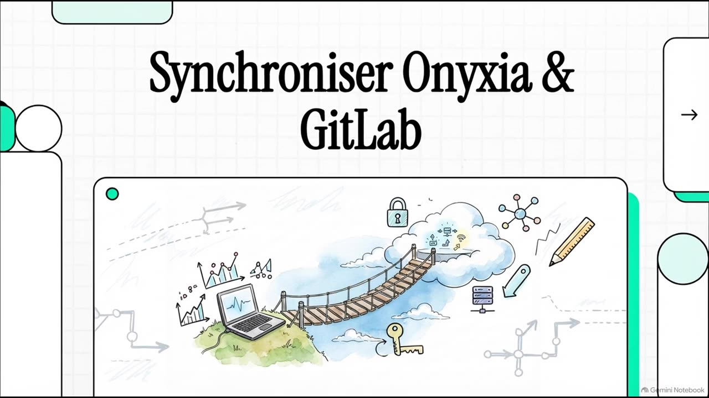
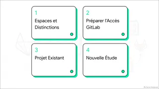
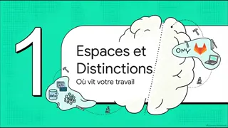
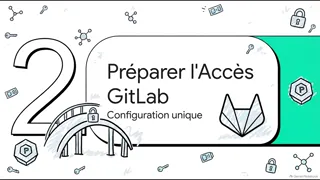
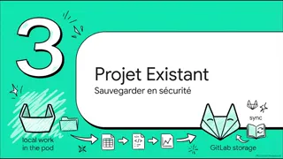
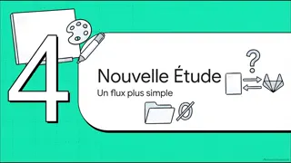
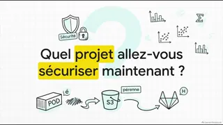

::: {.gbs-hero}
[Simulation pédagogique — données fictives]{.gbs-fiction}

[Atelier individuel · GitLab, VS Code, RStudio]{.gbs-kicker}

# Prendre en main GitLab, [un geste après l’autre.]{.gbs-hand}

[Créer un dépôt, préparer ton accès, cloner le projet dans ton environnement, puis envoyer une première modification. Et savoir quoi vérifier lorsque cela échoue.]{.gbs-lead}

```{=html}
<p class="gbs-hero-actions">
  <a class="gbs-btn gbs-btn-primary gbs-btn-film" href="#film" data-film-play>
    <svg class="gbs-btn-ico" viewBox="0 0 24 24" aria-hidden="true"><path d="M8 5.5v13l10.5-6.5z" fill="currentColor"/></svg>
    Regarder le film <span class="gbs-btn-meta">9 min</span>
  </a>
  <a class="gbs-btn gbs-btn-ghost" href="bac-a-sable.html">Ouvrir le bac à sable</a>
</p>
```
:::

::: {#gbs-resume .gbs-resume aria-live="polite"}
:::

```{=html}
<section id="film" class="gbs-film column-screen" aria-labelledby="film-titre">
  <div class="gbs-film-inner">
    <header class="gbs-film-head">
      <p class="gbs-film-kicker"><span class="gbs-film-dot" aria-hidden="true"></span>Le film · 9&nbsp;min&nbsp;25</p>
      <h2 id="film-titre" class="gbs-film-title">Synchroniser Onyxia <em>&amp;</em> GitLab</h2>
      <p class="gbs-film-lead">Où vit ton travail, comment préparer ton accès, puis les deux façons de relier ton pod à GitLab&nbsp;: ranger un travail qui existe déjà, ou démarrer une nouvelle étude.</p>
    </header>

    <div class="gbs-film-stage">
      <div class="gbs-player" data-film data-duree="564.6">
        <div class="gbs-player-frame">
          <video class="gbs-player-video" controls playsinline preload="none"
                 poster="assets/film/affiche.jpg" width="1280" height="720"
                 aria-label="Film : Synchroniser Onyxia &amp; GitLab">
            <source src="assets/film/synchroniser-onyxia-gitlab.mp4" type="video/mp4">
            <p>Ce navigateur ne lit pas la vidéo. <a href="assets/film/synchroniser-onyxia-gitlab.mp4" download>Télécharger le film (MP4, 38&nbsp;Mo)</a>.</p>
          </video>
          <button type="button" class="gbs-player-cover" hidden>
            
            <span class="gbs-player-shade" aria-hidden="true"></span>
            <span class="gbs-player-cta" aria-hidden="true">
              <span class="gbs-player-play"><svg viewBox="0 0 24 24" focusable="false"><path d="M8.5 5.8v12.4a.8.8 0 0 0 1.2.7l9.6-6.2a.8.8 0 0 0 0-1.4L9.7 5.1a.8.8 0 0 0-1.2.7z"/></svg></span>
              <span class="gbs-player-label"><strong class="gbs-player-action">Lire le film</strong><span class="gbs-player-meta">9&nbsp;min&nbsp;25 · avec le son</span></span>
            </span>
            <span class="gbs-player-progress" aria-hidden="true" hidden><span></span></span>
          </button>
          <div class="gbs-player-error" role="alert" hidden>
            <p><strong>La vidéo ne peut pas être lue ici.</strong></p>
            <p><button type="button" class="gbs-player-retry" data-film-retry hidden>Réessayer</button></p>
            <p><a href="assets/film/synchroniser-onyxia-gitlab.mp4" download>Télécharger le film (MP4, 38&nbsp;Mo)</a> pour le regarder avec un autre lecteur.</p>
          </div>
        </div>
      </div>

      <nav class="gbs-chapters" aria-labelledby="film-chapitres">
        <p id="film-chapitres" class="gbs-chapters-title">Chapitres <span class="gbs-chapters-count">6</span></p>
        <ol class="gbs-chapters-list">
          <li><a class="gbs-chapter" href="assets/film/synchroniser-onyxia-gitlab.mp4#t=0" data-t="0">
            <span class="gbs-chapter-thumb"></span>
            <span class="gbs-chapter-text">
              <span class="gbs-chapter-time"><span class="visually-hidden">Chapitre à </span><time datetime="PT0S">0:00</time><span class="gbs-chapter-eq" aria-hidden="true"><i></i><i></i><i></i></span></span>
              <span class="gbs-chapter-name">Introduction</span>
              <span class="gbs-chapter-desc">Le sommaire en quatre parties</span>
            </span>
            <span class="gbs-chapter-bar" aria-hidden="true"><span></span></span>
          </a></li>
          <li><a class="gbs-chapter" href="assets/film/synchroniser-onyxia-gitlab.mp4#t=44.4" data-t="44.4">
            <span class="gbs-chapter-thumb"></span>
            <span class="gbs-chapter-text">
              <span class="gbs-chapter-time"><span class="visually-hidden">Chapitre à </span><time datetime="PT44S">0:44</time><span class="gbs-chapter-eq" aria-hidden="true"><i></i><i></i><i></i></span></span>
              <span class="gbs-chapter-name">1 · Espaces et distinctions</span>
              <span class="gbs-chapter-desc">Où vit ton travail&nbsp;: pod, S3, GitLab</span>
            </span>
            <span class="gbs-chapter-bar" aria-hidden="true"><span></span></span>
          </a></li>
          <li><a class="gbs-chapter" href="assets/film/synchroniser-onyxia-gitlab.mp4#t=151.2" data-t="151.2">
            <span class="gbs-chapter-thumb"></span>
            <span class="gbs-chapter-text">
              <span class="gbs-chapter-time"><span class="visually-hidden">Chapitre à </span><time datetime="PT2M31S">2:31</time><span class="gbs-chapter-eq" aria-hidden="true"><i></i><i></i><i></i></span></span>
              <span class="gbs-chapter-name">2 · Préparer l’accès GitLab</span>
              <span class="gbs-chapter-desc">Une configuration unique&nbsp;: le jeton</span>
            </span>
            <span class="gbs-chapter-bar" aria-hidden="true"><span></span></span>
          </a></li>
          <li><a class="gbs-chapter" href="assets/film/synchroniser-onyxia-gitlab.mp4#t=248.8" data-t="248.8">
            <span class="gbs-chapter-thumb"></span>
            <span class="gbs-chapter-text">
              <span class="gbs-chapter-time"><span class="visually-hidden">Chapitre à </span><time datetime="PT4M8S">4:08</time><span class="gbs-chapter-eq" aria-hidden="true"><i></i><i></i><i></i></span></span>
              <span class="gbs-chapter-name">3 · Projet existant</span>
              <span class="gbs-chapter-desc">Ranger le travail du pod sur GitLab</span>
            </span>
            <span class="gbs-chapter-bar" aria-hidden="true"><span></span></span>
          </a></li>
          <li><a class="gbs-chapter" href="assets/film/synchroniser-onyxia-gitlab.mp4#t=504.7" data-t="504.7">
            <span class="gbs-chapter-thumb"></span>
            <span class="gbs-chapter-text">
              <span class="gbs-chapter-time"><span class="visually-hidden">Chapitre à </span><time datetime="PT8M24S">8:24</time><span class="gbs-chapter-eq" aria-hidden="true"><i></i><i></i><i></i></span></span>
              <span class="gbs-chapter-name">4 · Nouvelle étude</span>
              <span class="gbs-chapter-desc">Un flux plus simple&nbsp;: README et clone</span>
            </span>
            <span class="gbs-chapter-bar" aria-hidden="true"><span></span></span>
          </a></li>
          <li><a class="gbs-chapter" href="assets/film/synchroniser-onyxia-gitlab.mp4#t=540.9" data-t="540.9">
            <span class="gbs-chapter-thumb"></span>
            <span class="gbs-chapter-text">
              <span class="gbs-chapter-time"><span class="visually-hidden">Chapitre à </span><time datetime="PT9M1S">9:01</time><span class="gbs-chapter-eq" aria-hidden="true"><i></i><i></i><i></i></span></span>
              <span class="gbs-chapter-name">Conclusion</span>
              <span class="gbs-chapter-desc">Quel projet sécuriser maintenant&nbsp;?</span>
            </span>
            <span class="gbs-chapter-bar" aria-hidden="true"><span></span></span>
          </a></li>
        </ol>
      </nav>
    </div>

    <div class="gbs-film-foot">
      <details class="gbs-film-texte">
        <summary><span class="gbs-film-texte-ico" aria-hidden="true"></span>Version texte&nbsp;: les points clés du film</summary>
        <div class="gbs-film-texte-body">
          <div class="gbs-film-chap">
            <h3><span class="gbs-film-t">0:00</span>Introduction</h3>
            <p>Le titre, puis le sommaire&nbsp;: espaces et distinctions, préparer l’accès GitLab, projet existant, nouvelle étude.</p>
          </div>
          <div class="gbs-film-chap">
            <h3><span class="gbs-film-t">0:44</span>1 · Espaces et distinctions</h3>
            <ul>
              <li>Le pod Onyxia est éphémère, le stockage S3 est permanent. GitLab est l’espace collaboratif qui conserve l’historique.</li>
              <li>Le trajet d’une modification&nbsp;: préparer le dossier, passer par la zone de préparation, enregistrer un commit, puis l’envoyer vers GitLab (push).</li>
              <li>Trois notions distinctes&nbsp;: l’identité (qui signe les commits), l’authentification (prouver qui tu es, avec un jeton personnel) et l’autorisation (ce que permet le scope du jeton).</li>
            </ul>
          </div>
          <div class="gbs-film-chap">
            <h3><span class="gbs-film-t">2:31</span>2 · Préparer l’accès GitLab</h3>
            <ul>
              <li>Une configuration unique&nbsp;: avatar › <i>Edit profile</i> › <i>Access</i> › <i>Personal access tokens</i> › <i>Generate token</i> › <i>Legacy token</i>. Un nom, une date d’expiration proche, le scope <code>write_repository</code>.</li>
              <li>Le jeton n’est affiché qu’une fois&nbsp;: range-le dans un gestionnaire sécurisé. Il remplace le mot de passe pour Git et ne va jamais dans l’URL. Perdu, il ne se récupère pas&nbsp;: on en crée un autre.</li>
              <li>Ton nom et ton e-mail se règlent avec <code>git config</code>&nbsp;; Onyxia les renseigne souvent automatiquement.</li>
            </ul>
          </div>
          <div class="gbs-film-chap">
            <h3><span class="gbs-film-t">4:08</span>3 · Projet existant</h3>
            <ul>
              <li>Objectif&nbsp;: sauvegarder sur GitLab le travail du pod, sans le lourd fichier de données CSV.</li>
              <li>Sur GitLab, un projet vide&nbsp;: la case README reste décochée.</li>
              <li>Dans le pod&nbsp;: un <code>.gitignore</code> pour écarter les données, <code>git init</code>, puis le premier commit (<code>git add .</code>, <code>git commit -m</code>, <code>git status</code>).</li>
              <li>Copier l’URL HTTPS, <code>git remote add origin</code>, puis <code>git push -u origin main</code>&nbsp;; le jeton sert de mot de passe.</li>
              <li>Push rejeté&nbsp;? Vérifie qu’aucun README n’a été créé par erreur sur GitLab. Pour finir, contrôle sur GitLab que le commit est là et que le CSV n’y est pas.</li>
            </ul>
            <p class="gbs-film-link"><a href="bac-a-sable.html?mission=m1b">S’entraîner&nbsp;: parcours B, j’ai déjà du travail <span aria-hidden="true">→</span></a></p>
          </div>
          <div class="gbs-film-chap">
            <h3><span class="gbs-film-t">8:24</span>4 · Nouvelle étude</h3>
            <p>Quand rien n’existe encore, un flux plus simple&nbsp;: au lieu d’initialiser le dossier dans le pod puis de le relier à un dépôt vide, créer le projet GitLab avec un README et le cloner directement dans le pod.</p>
            <p class="gbs-film-link"><a href="bac-a-sable.html?mission=m1">S’entraîner&nbsp;: parcours A, je démarre de zéro <span aria-hidden="true">→</span></a></p>
          </div>
          <div class="gbs-film-chap">
            <h3><span class="gbs-film-t">9:01</span>Conclusion</h3>
            <p>La question de fin&nbsp;: «&nbsp;Quel projet allez-vous sécuriser maintenant&nbsp;?&nbsp;»</p>
          </div>
        </div>
      </details>
      <p class="gbs-film-note">Film réalisé avec NotebookLM. Il n’a pas de sous-titres&nbsp;: la version texte en reprend les points clés.
        <a href="assets/film/synchroniser-onyxia-gitlab.mp4" download>Télécharger le film (MP4, 38&nbsp;Mo)</a></p>
    </div>
  </div>
</section>
<script src="assets/film/film.js" defer></script>
```

## Deux situations, deux bonnes pratiques

```{=html}
<ul class="gbs-cards">
  <li class="gbs-card">
    <span class="gbs-num" aria-hidden="true">A</span>
    <h3>Je démarre de zéro</h3>
    <p>Rien n’existe encore. Je crée le projet GitLab <strong>avec un README</strong>, puis je le clone tout de suite dans mon pod : mon environnement est relié à GitLab dès le début.</p>
    <a class="gbs-card-go" href="bac-a-sable.html?mission=m1">Parcours A →</a>
  </li>
  <li class="gbs-card">
    <span class="gbs-num" aria-hidden="true">B</span>
    <h3>J’ai déjà du travail dans mon pod</h3>
    <p>Mon étude existe dans mon pod Onyxia. Je crée le projet GitLab <strong>sans README</strong> (vide), j’initialise mon dossier, je le relie à GitLab et j’y envoie mon travail.</p>
    <a class="gbs-card-go" href="bac-a-sable.html?mission=m1b">Parcours B →</a>
  </li>
</ul>
```

| | A · Je démarre de zéro | B · J’ai déjà du travail |
|---|---|---|
| Case *Initialize repository with a README* | **cochée** | **décochée** : projet vide |
| Le dépôt naît… | sur GitLab, avec un premier commit | dans le pod, avec `git init` |
| Relier le pod à GitLab | `git clone <URL>` | `git remote add origin <URL>` |
| Premier envoi | `git push` (branche déjà suivie) | `git push -u origin main` |
| Si on se trompe | un dossier vide à côté de son travail | push refusé : deux historiques sans lien (exercice 6.10) |

## Trois façons de s’exercer

Le même simulateur sert aux trois. Tu peux passer de l’une à l’autre à tout moment ; ta progression est conservée dans ce navigateur.

```{=html}
<ul class="gbs-cards">
  <li class="gbs-card">
    <span class="gbs-num" aria-hidden="true">1</span>
    <h3>Parcours guidé</h3>
    <p>Une consigne à la fois. Chaque geste est expliqué au moment où il devient utile.</p>
    <a class="gbs-card-go" href="bac-a-sable.html?mission=m1&amp;mode=guide">Commencer (parcours A) →</a>
  </li>
  <li class="gbs-card">
    <span class="gbs-num" aria-hidden="true">2</span>
    <h3>Entraînement autonome</h3>
    <p>L’objectif reste visible, les indications détaillées sont masquées. Les aides restent disponibles si tu en as besoin.</p>
    <a class="gbs-card-go" href="bac-a-sable.html?mission=m1&amp;mode=autonome">S’entraîner →</a>
  </li>
  <li class="gbs-card">
    <span class="gbs-num" aria-hidden="true">3</span>
    <h3>Atelier de dépannage</h3>
    <p>Dix situations problématiques : observer, vérifier une hypothèse, identifier la cause, agir.</p>
    <a class="gbs-card-go" href="bac-a-sable.html?mission=d1">Ouvrir l’atelier →</a>
  </li>
</ul>
```

## L’objectif

> « Je sais créer un dépôt GitLab, préparer mon accès, cloner ce dépôt dans mon environnement de travail, puis envoyer une première modification. Je sais aussi quoi vérifier lorsque cela échoue. »

```{mermaid}
%%| fig-cap: "Le trajet d’une modification. Le simulateur affiche ces quatre zones en permanence."
flowchart LR
  G[("GitLab<br/>dépôt distant")] -- "A · git clone<br/>B · git init + remote" --> F["Fichiers de travail"]
  F -- "2 · git add" --> P["Préparation"]
  P -- "3 · git commit" --> L[("Historique local")]
  L -- "4 · git push<br/>(jeton)" --> G
```

Le **dépôt local** se trouve là où Git travaille : ton ordinateur, ou un espace distant de développement comme Coder ou Onyxia.

## Les missions

```{=html}
<ol class="gbs-missions" id="gbs-missions">
  <li data-m="m1"><span class="gbs-m-num">A</span><a href="bac-a-sable.html?mission=m1">Parcours A · Je démarre de zéro (5 missions)</a><span class="gbs-m-status">À faire</span></li>
  <li data-m="m1b"><span class="gbs-m-num">B</span><a href="bac-a-sable.html?mission=m1b">Parcours B · J’ai déjà du travail dans mon pod (5 missions)</a><span class="gbs-m-status">À faire</span></li>
  <li data-m="m6"><span class="gbs-m-num">6</span><a href="bac-a-sable.html?mission=d1">Comprendre une erreur — 10 exercices</a><span class="gbs-m-status">À faire</span></li>
  <li data-m="m7"><span class="gbs-m-num">7</span><a href="bac-a-sable.html?mission=m7">Refaire seul, en situation A ou B</a><span class="gbs-m-status">À faire</span></li>
</ol>
```

Le simulateur propose **VS Code par défaut**, et un parcours complet dans **RStudio**. Le choix se fait en haut du bac à sable ; tu peux consulter à tout moment le même geste dans l’autre interface.

::: {.callout-note appearance="simple"}
## Avant de commencer

- Rien de ce que tu fais ici ne touche un vrai serveur ni ta machine : le terminal est simulé.
- Les jetons générés portent le préfixe `DEMO-TOKEN-`. Ne saisis **jamais** un vrai jeton dans ce site : les champs le refusent et l’effacent.
- La progression est enregistrée dans ce navigateur, sur cet appareil. Un autre navigateur repart de zéro.
:::

Après l’entraînement : la fiche [Je le fais dans mes outils](dans-mes-outils.qmd) t’accompagne dans tes véritables outils.

```{=html}
<script src="assets/sim/home.js"></script>
```
